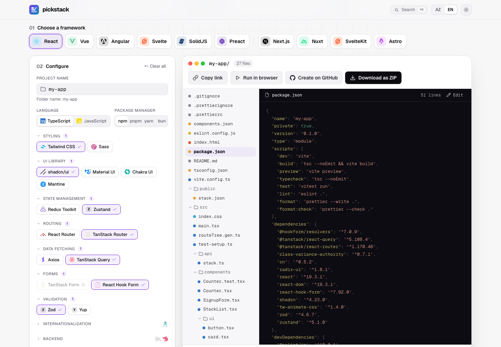

# pickstack

**Pick a framework and tools, watch the files change, and get a ready-to-run frontend project.**

[](https://www.npmjs.com/package/create-pickstack)
[](https://www.npmjs.com/package/create-pickstack)
[](LICENSE)
[](https://pickstack.online)

[**pickstack.online**](https://pickstack.online) · [npm](https://www.npmjs.com/package/create-pickstack) · [Starter templates](https://pickstack.online/stacks/)



## Three ways, one project

1. **In the terminal (fastest).** Answer a few questions; the project is created and its packages installed.

   ```bash
   npm create pickstack@latest
   ```

2. **Pick on the site, copy the command.** Everything you pick on [pickstack.online](https://pickstack.online) becomes one command that creates the same project with no questions:

   ```bash
   npm create pickstack@latest my-app -- --framework react --modules tailwind,shadcn,tanstack-router,tanstack-query,vitest --yes
   ```

3. **Straight from the site, no terminal.** Download a ZIP, create a GitHub repository, or run the project in the browser with StackBlitz.

`pnpm create pickstack`, `yarn create pickstack` and `bun create pickstack` work too.

## What you can pick

**10 frameworks:** React, Vue, Angular, Svelte, SolidJS, Preact, Next.js, Nuxt, SvelteKit, Astro, in TypeScript or JavaScript, with npm, pnpm, yarn or bun.

**61 modules in 21 categories**, offered only where they work with your framework:

| Category                 | Options                                                                                                    |
| ------------------------ | ---------------------------------------------------------------------------------------------------------- |
| Styling                  | Tailwind CSS, Sass                                                                                         |
| UI library               | shadcn/ui, Material UI, Chakra UI, Mantine, shadcn-vue, PrimeVue, Vuetify, shadcn-svelte, Angular Material |
| State                    | Redux Toolkit, Zustand, Pinia, built-in stores                                                             |
| Routing                  | React Router, TanStack Router, Vue Router, Solid Router, preact-iso                                        |
| Data fetching            | TanStack Query, Axios                                                                                      |
| Forms and validation     | TanStack Form, React Hook Form · Zod or Yup                                                                |
| Internationalization     | react-i18next, Vue I18n                                                                                    |
| Backend and database     | Express or NestJS API · PostgreSQL (Drizzle) or MongoDB                                                    |
| Authentication           | Better Auth (email and password, with a sign-in form)                                                      |
| Monitoring and analytics | Sentry · Matomo, Plausible, Umami                                                                          |
| Testing                  | Vitest, Testing Library, Playwright                                                                        |
| Code quality             | ESLint, Prettier, Biome, Husky + lint-staged                                                               |
| SEO                      | Meta tags, sitemap, robots.txt, `llms.txt` for AI search                                                   |
| Tooling                  | Turborepo, Module Federation, PWA, Storybook, GitHub Actions CI, EditorConfig                              |
| Deploy                   | Vercel, Netlify, Cloudflare, Docker                                                                        |
| AI agents                | AGENTS.md, Claude Code, Cursor, GitHub Copilot                                                             |

Conflicting picks are explained instead of hidden, and anything a module needs is added for you.

## Every combination is built for real

The generated code is meant to be yours to keep: plain, idiomatic files, written from each tool's official docs, with versions pinned to a known-good set. A smoke suite of 174 combinations installs, builds, typechecks, lints and tests each project before a release.

## For AI agents

`create-pickstack --mcp` runs an MCP server, so agents such as Claude Code or Cursor can list the options, preview a project and create it:

```json
{
  "mcpServers": {
    "pickstack": {
      "command": "npx",
      "args": ["-y", "create-pickstack@latest", "--mcp"]
    }
  }
}
```

## Development

A pnpm monorepo: `packages/core` is the generator (it runs in the browser and in Node), `packages/cli` is `create-pickstack`, and `apps/web` is the site.

```bash
pnpm install
pnpm dev              # the site
pnpm test             # unit and snapshot tests
pnpm typecheck
pnpm lint
pnpm smoke --quick    # builds a curated set of generated projects
```

The plan and the support matrix live in [docs/SPEC.md](docs/SPEC.md).

## License

[MIT](LICENSE)
